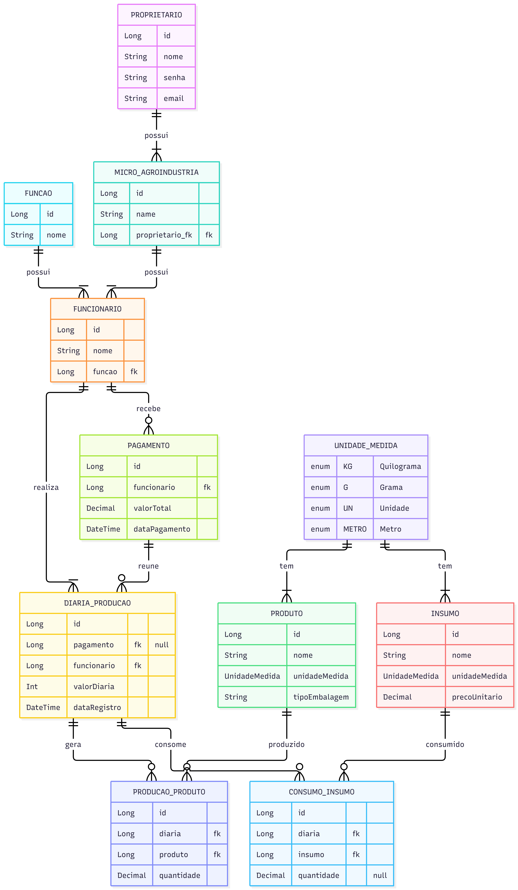

# Sistema de Gestão de Micro Agroindústria

Cada história está associada a um relacionamento do diagrama ER.

**Personas**
- **Proprietário**: dono da micro agroindústria, quem usa o sistema.
- **Funcionário**: trabalhador pago por diária (raspador, gomeiro, forneiro etc.). Não acessa o sistema.

---

## 1. PROPRIETARIO → MICRO_AGROINDUSTRIA (possui)

**Cardinalidade:** um proprietário possui uma ou mais agroindústrias.

- **US01** Como **proprietário**, quero cadastrar minha agroindústria, para que meus dados fiquem organizados dentro do sistema.
- **US02** Como **proprietário**, quero cadastrar mais de uma agroindústria na mesma conta, para gerenciar todos os meus negócios em um só lugar.
- **US03** Como **proprietário**, quero ver apenas os dados das minhas agroindústrias, para que ninguém além de mim acesse minhas informações.

**Critérios de aceite**
- Toda agroindústria pertence a exatamente um proprietário.
- Um proprietário só visualiza e edita as agroindústrias que são dele.

---

## 2. MICRO_AGROINDUSTRIA → FUNCIONARIO (possui)

**Cardinalidade:** uma agroindústria possui um ou mais funcionários.

- **US04** Como **proprietário**, quero cadastrar funcionários na minha agroindústria, para poder registrar o trabalho e os pagamentos deles.
- **US05** Como **proprietário**, quero listar todos os funcionários de uma agroindústria, para saber quem trabalha comigo.
- **US06** Como **proprietário**, quero editar ou desativar um funcionário, para manter o cadastro atualizado quando alguém sair, sem perder o histórico de diárias.

**Critérios de aceite**
- Todo funcionário pertence a uma única agroindústria.
- Funcionários desativados continuam aparecendo nos registros antigos.

---

## 3. FUNCAO → FUNCIONARIO (possui)

**Cardinalidade:** uma função é exercida por vários funcionários; cada funcionário tem uma função.

- **US07** Como **proprietário**, quero cadastrar funções (raspador, gomeiro, forneiro), para classificar o trabalho de cada pessoa.
- **US08** Como **proprietário**, quero associar uma função a cada funcionário, para saber o que cada um faz na produção.
- **US09** Como **proprietário**, quero filtrar funcionários por função, para ver rapidamente, por exemplo, todos os raspadores.

**Critérios de aceite**
- Não é possível cadastrar um funcionário sem função.
- Não é possível excluir uma função que ainda tenha funcionários associados.

---

## 4. FUNCIONARIO → DIARIA_PRODUCAO (realiza)

**Cardinalidade:** um funcionário realiza várias diárias; cada diária é de um único funcionário.

- **US10** Como **proprietário**, quero registrar a diária de um funcionário em uma data, informando o valor, para controlar quanto devo a ele.
- **US11** Como **proprietário**, quero ver o histórico de diárias de um funcionário, para conferir o que ele trabalhou em um período.
- **US12** Como **proprietário**, quero ver o total de diárias ainda não pagas de cada funcionário, para saber quanto devo a ele hoje.
- **US13** Como **proprietário**, quero editar uma diária que ainda não foi paga, para corrigir erros de digitação.

**Critérios de aceite**
- Toda diária tem funcionário, data e valor.
- Diárias já vinculadas a um pagamento não podem ser editadas nem excluídas.

---

## 5. PAGAMENTO → DIARIA_PRODUCAO (reúne)

**Cardinalidade:** um pagamento reúne várias diárias; uma diária pertence a no máximo um pagamento (fica sem pagamento até ser paga).

- **US14** Como **proprietário**, quero gerar um pagamento somando as diárias pendentes de um funcionário, para pagá-lo sem precisar calcular manualmente.
- **US15** Como **proprietário**, quero ver quais diárias compõem cada pagamento, para conferir ou explicar o valor pago.
- **US16** Como **proprietário**, quero que as diárias já pagas sejam marcadas como quitadas, para não pagar a mesma diária duas vezes.
- **US17** Como **proprietário**, quero consultar o histórico de pagamentos, para ter controle financeiro da agroindústria.

**Critérios de aceite**
- O valor total do pagamento é a soma do valor das diárias vinculadas.
- Uma diária só pode ser vinculada a um pagamento.
- Diárias já vinculadas não aparecem como pendentes.

---

## 6. UNIDADE_MEDIDA → PRODUTO (tem)

**Cardinalidade:** uma unidade de medida pode ser usada em vários produtos; cada produto tem uma unidade.

- **US18** Como **proprietário**, quero cadastrar produtos (goma, farinha) com sua unidade de medida (kg, saco/UN), para registrar a produção com a medida certa.
- **US19** Como **proprietário**, quero informar o tipo de embalagem do produto, para diferenciar, por exemplo, farinha em saco de farinha a granel.

**Critérios de aceite**
- Todo produto precisa ter uma unidade de medida (KG, G, UN ou METRO).

---

## 7. UNIDADE_MEDIDA → INSUMO (tem)

**Cardinalidade:** uma unidade de medida pode ser usada em vários insumos; cada insumo tem uma unidade.

- **US20** Como **proprietário**, quero cadastrar insumos (mandioca, lenha) com sua unidade de medida, para registrar o consumo corretamente.
- **US21** Como **proprietário**, quero informar o preço unitário do insumo, para estimar o custo da produção.

**Critérios de aceite**
- Todo insumo precisa ter uma unidade de medida.

---

## 8. DIARIA_PRODUCAO → PRODUCAO_PRODUTO (gera)

**Cardinalidade:** uma diária pode gerar zero ou mais produções; cada registro de produção pertence a uma diária.

- **US22** Como **proprietário**, quero registrar o que o funcionário produziu na diária (ex: Theo produziu 500 kg de goma), para saber a produção de cada dia.
- **US23** Como **proprietário**, quero registrar mais de um produto na mesma diária, para o caso de o funcionário produzir itens diferentes no mesmo dia.
- **US24** Como **proprietário**, quero registrar uma diária sem nenhuma produção (ex: raspador), para não ser obrigado a informar produto quando não houver.

**Critérios de aceite**
- A produção é opcional.
- Cada registro de produção informa produto e quantidade.

---

## 9. PRODUTO → PRODUCAO_PRODUTO (produzido)

**Cardinalidade:** um produto pode aparecer em várias produções; cada registro de produção refere-se a um único produto.

- **US25** Como **proprietário**, quero ver o total produzido de cada produto em um período, para acompanhar o rendimento da agroindústria.
- **US26** Como **proprietário**, quero ver quais funcionários produziram determinado produto, para saber quem contribuiu em cada produção.

---

## 10. DIARIA_PRODUCAO → CONSUMO_INSUMO (consome)

**Cardinalidade:** uma diária pode consumir zero ou mais insumos; cada registro de consumo pertence a uma diária.

- **US27** Como **proprietário**, quero registrar o insumo consumido na diária (ex: João raspou 1000 kg de mandioca), para saber quanto de matéria-prima foi usada por dia.
- **US28** Como **proprietário**, quero registrar o consumo de um insumo sem informar a quantidade (ex: lenha usada pelo Zé), para registrar que foi usado mesmo sem medir.
- **US29** Como **proprietário**, quero registrar uma diária sem consumo de insumo, para o caso em que o funcionário não consumiu matéria-prima registrada.

**Critérios de aceite**
- O consumo é opcional.
- A quantidade pode ficar em branco.

---

## 11. INSUMO → CONSUMO_INSUMO (consumido)

**Cardinalidade:** um insumo pode aparecer em vários consumos; cada registro de consumo refere-se a um único insumo.

- **US30** Como **proprietário**, quero ver o total consumido de cada insumo em um período, para saber quanto de mandioca foi usada.
- **US31** Como **proprietário**, quero comparar o consumo de insumo com a produção gerada, para avaliar o rendimento (ex: kg de mandioca por kg de goma).

---

## Melhorias futuras (fora do escopo desta entrega)

- **Preço por função com sugestão de valor:** o sistema calcularia `quantidade × preço da função` e avisaria o proprietário caso o valor digitado fosse diferente, sem bloquear. Exigiria uma tabela `PRECO_FUNCAO` e os campos `valorSugerido`, `valorAjustado` e `justificativa` na diária.
- **Rastreabilidade da mandioca raspada:** tratar a mandioca raspada como produto intermediário, ligando o trabalho do raspador ao do gomeiro e do forneiro.
- **Despesas:** preencher a entidade `DESPESA` para controlar custos como lenha e embalagem.